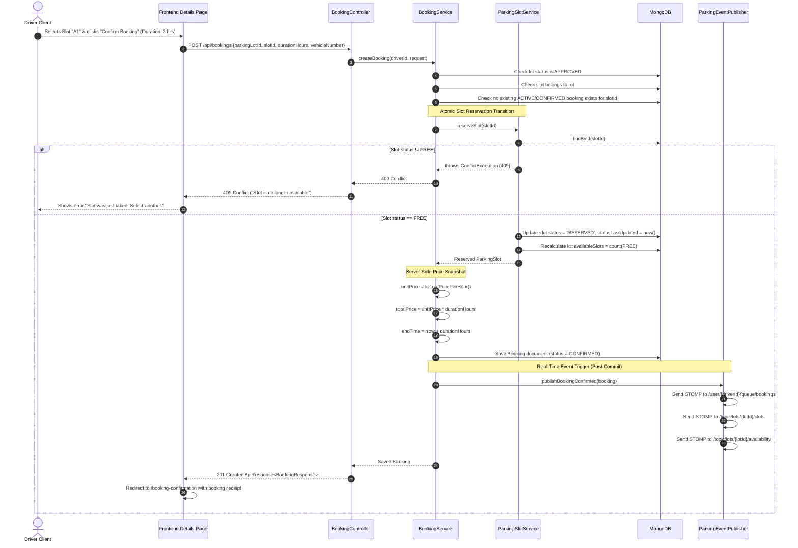
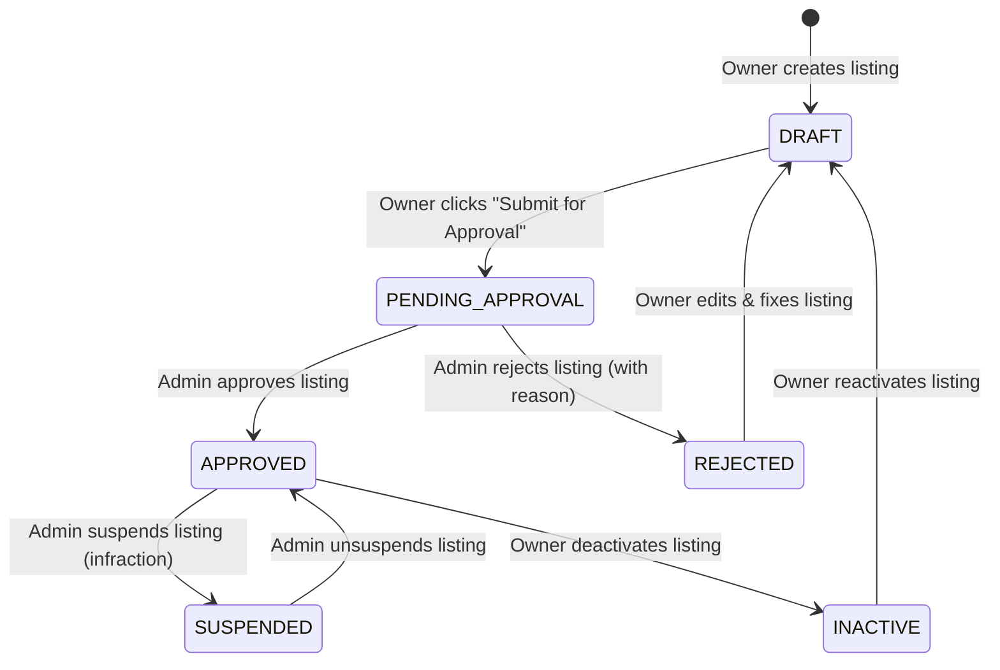
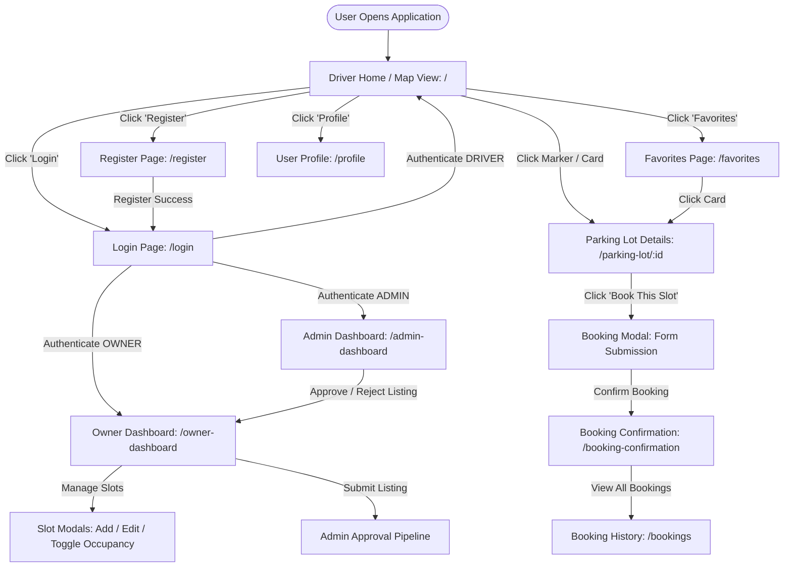
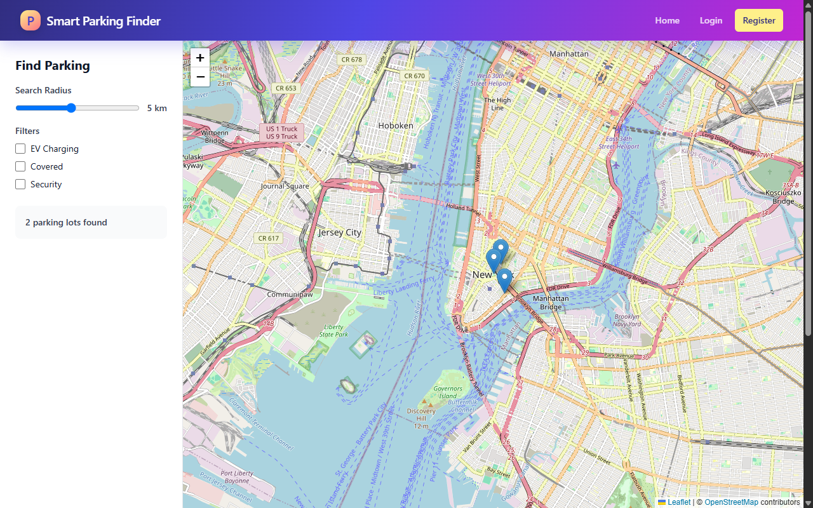
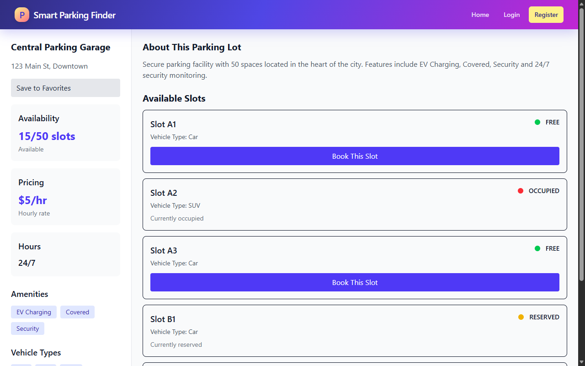
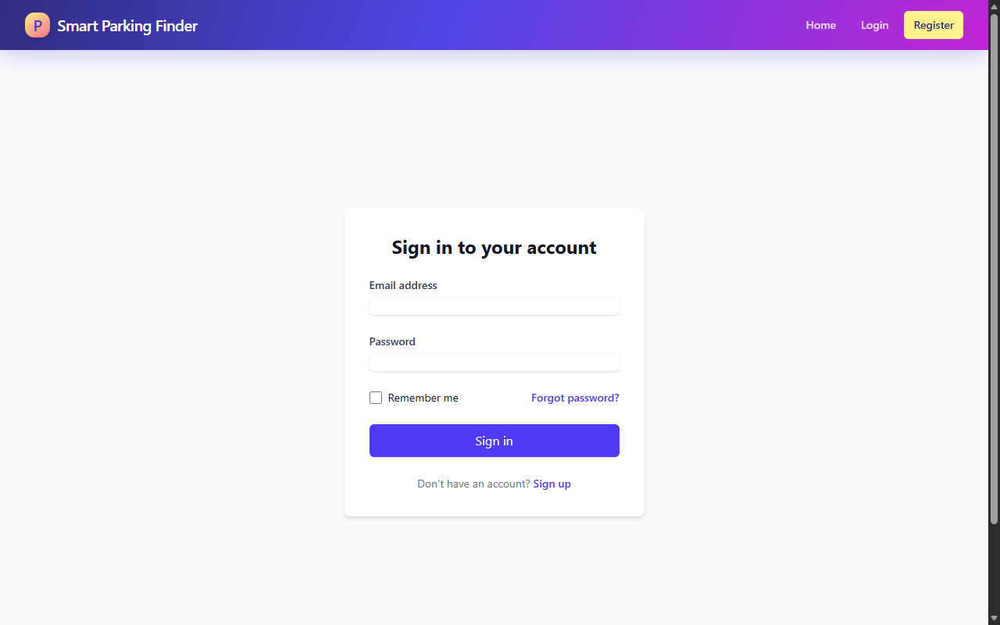
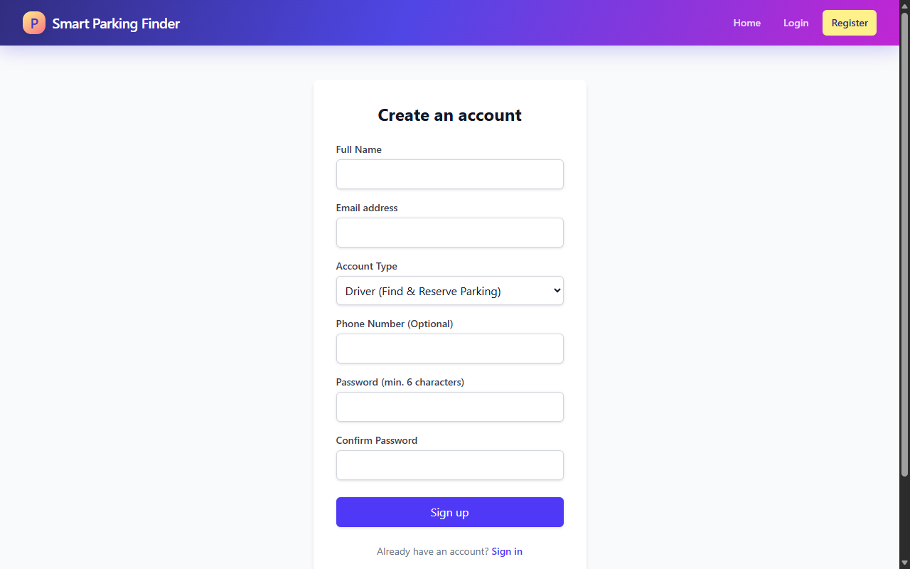
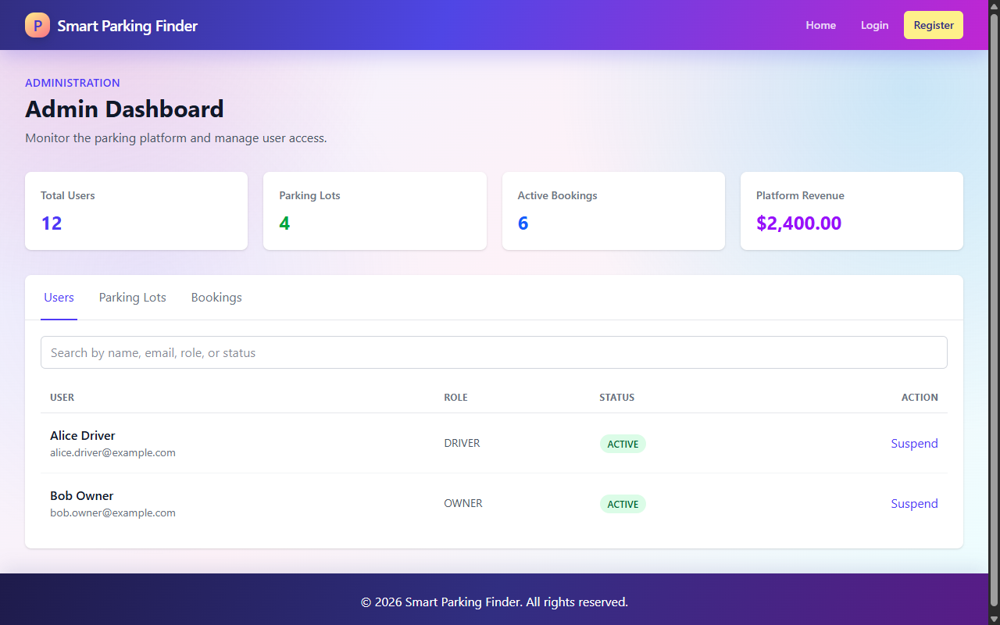
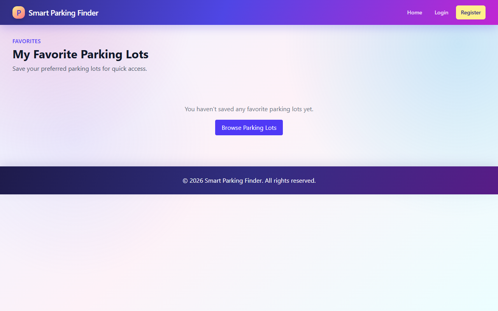
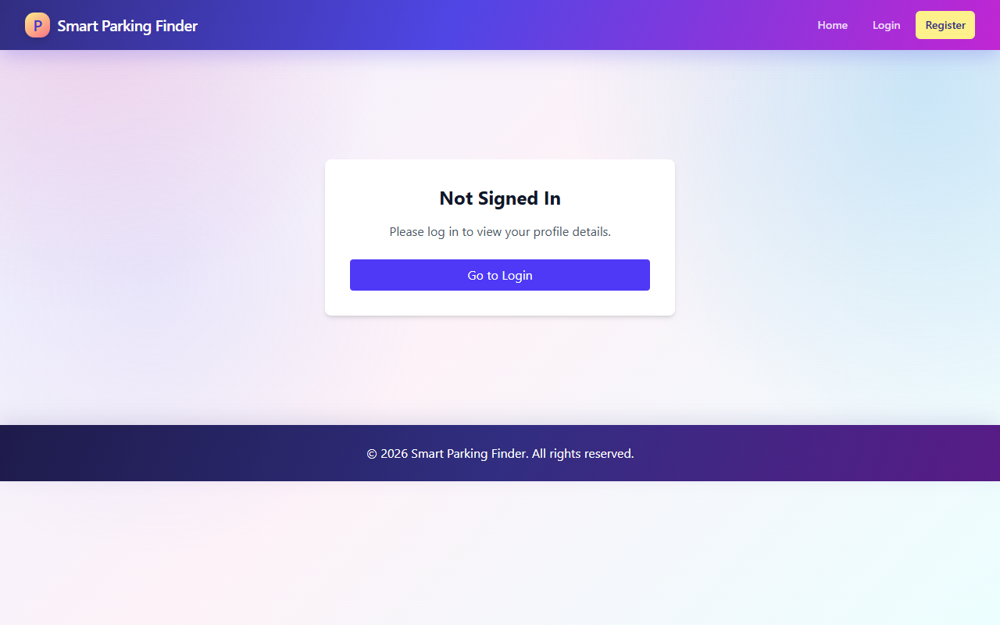

# Smart Parking Finder — Comprehensive Project Architecture & Technical Documentation

**Document Version:** 1.0.0  
**Target Environment:** Spring Boot 3.4.1 (Java 21) | MongoDB | React 19 (Vite) | Leaflet / OSRM  
**Location:** `/docs/PROJECT_DOCUMENTATION.md`

---

## Table of Contents

1. [Executive Summary & System Overview](#1-executive-summary--system-overview)
2. [Architecture & Technology Stack](#2-architecture--technology-stack)
3. [End-to-End System Data Flows (Sync & Async)](#3-end-to-end-system-data-flows-sync--async)
   - [3.1 User Registration, Login & Session Management Flow](#31-user-registration-login--session-management-flow)
   - [3.2 Two-Stage Road-Distance Parking Search Flow](#32-two-stage-road-distance-parking-search-flow)
   - [3.3 Concurrency-Safe Slot Reservation & Booking Lifecycle](#33-concurrency-safe-slot-reservation--booking-lifecycle)
   - [3.4 Real-Time WebSocket & STOMP Asynchronous Event Flow](#34-real-time-websocket--stomp-asynchronous-event-flow)
   - [3.5 Parking Facility Onboarding & Admin Approval Workflow](#35-parking-facility-onboarding--admin-approval-workflow)
   - [3.6 Visibility Subscription & Search Radius Gating Flow](#36-visibility-subscription--search-radius-gating-flow)
   - [3.7 Automated Background Schedulers Flow](#37-automated-background-schedulers-flow)
4. [Comprehensive Schema & Entity Reference](#4-comprehensive-schema--entity-reference)
   - [4.1 Global API Envelope Specification](#41-global-api-envelope-specification)
   - [4.2 System Enums & Allowed Domains](#42-system-enums--allowed-domains)
   - [4.3 MongoDB Document Schemas](#43-mongodb-document-schemas)
5. [Complete REST & WebSocket API Route Directory](#5-complete-rest--websocket-api-route-directory)
   - [5.1 Authentication API (`/api/auth`)](#51-authentication-api-apiauth)
   - [5.2 Public Search API (`/api/search`)](#52-public-search-api-apisearch)
   - [5.3 Parking Lot Management API (`/api/parking/lots`)](#53-parking-lot-management-api-apiparkinglots)
   - [5.4 Parking Slot Management API (`/api/parking/slots`)](#54-parking-slot-management-api-apiparkingslots)
   - [5.5 Booking Management API (`/api/bookings`, `/api/owner/bookings`)](#55-booking-management-api-apibookings-apiownerbookings)
   - [5.6 Subscription & Plan Management API (`/api/subscriptions`, `/api/admin/subscriptions`, `/api/admin/plans`)](#56-subscription--plan-management-api-apisubscriptions-apiadminsubscriptions-apiadminplans)
   - [5.7 Favourites API (`/api/favourites`)](#57-favourites-api-apifavourites)
   - [5.8 User Profile & Account API (`/api/users`)](#58-user-profile--account-api-apiusers)
   - [5.9 Admin Operations & Audit API (`/api/admin`)](#59-admin-operations--audit-api-apiadmin)
   - [5.10 WebSocket / STOMP Real-Time Topics](#510-websocket--stomp-real-time-topics)
6. [Backend Services & Core Logic Deep Dive](#6-backend-services--core-logic-deep-dive)
7. [Frontend Architecture, Screen Navigation & UI Walkthrough](#7-frontend-architecture-screen-navigation--ui-walkthrough)
   - [7.1 Frontend Application Architecture](#71-frontend-application-architecture)
   - [7.2 User Navigation Flowchart](#72-user-navigation-flowchart)
   - [7.3 Visual Screen Journey & Live UI Capture](#73-visual-screen-journey--live-ui-capture)
8. [Configuration, Environment Variables & Deployment](#8-configuration-environment-variables--deployment)
9. [Security, Concurrency & Data Integrity Guarantees](#9-security-concurrency--data-integrity-guarantees)

---

## 1. Executive Summary & System Overview

**Smart Parking Finder** is a full-stack, enterprise-grade smart parking platform engineered to solve urban parking congestion, inaccurate parking availability, and straight-line distance miscalculations.

### Key Value Propositions
* **True Road-Distance Routing:** Unlike traditional apps that measure euclidean ("as-the-crow-flies") distance, Smart Parking Finder integrates with the Open Source Routing Machine (OSRM) to calculate actual road travel distance and driving duration.
* **Tiered Visibility Control:** Parking lot owners subscribe to radius plans (1 km to 5 km). The search engine enforces these visibility boundaries strictly on the backend.
* **Concurrency-Safe Slot Reservations:** Prevents race conditions and double-bookings through atomic state transitions and price snapshot guarantees.
* **Bi-directional Live Updates:** Real-time slot status and availability metrics broadcasted via WebSockets (STOMP over SockJS) and polling hooks.
* **Role-Based Workflows:** Distinct operational interfaces and security barriers for **Drivers**, **Lot Owners**, and **Platform Administrators**.

---

## 2. Architecture & Technology Stack

```
 ┌────────────────────────────────────────────────────────────────────────┐
 │                              CLIENT TIER                               │
 │   React 19 SPA (Vite) + Tailwind CSS + React-Leaflet + Lucide Icons    │
 └──────────────────┬─────────────────────────────────┬───────────────────┘
                    │ HTTPS / REST (Session Cookies)  │ WSS (STOMP/SockJS)
                    ▼                                 ▼
 ┌────────────────────────────────────────────────────────────────────────┐
 │                           APPLICATION TIER                             │
 │                    Spring Boot 3.4.1 (Java 21)                         │
 │                                                                        │
 │  ┌──────────────────────────────────────────────────────────────────┐  │
 │  │ Security Filter Chain: Session Auth, BCrypt, RBAC, UserPrincipal │  │
 │  └──────────────────────────────────────────────────────────────────┘  │
 │  ┌──────────────────────────────────────────────────────────────────┐  │
 │  │ Controllers: Auth, Search, Lots, Slots, Bookings, Plans, Admin   │  │
 │  └──────────────────────────────────────────────────────────────────┘  │
 │  ┌──────────────────────────────────────────────────────────────────┐  │
 │  │ Services: SearchEngine, ConcurrencyBooking, OSRMClient, Audit   │  │
 │  └──────────────────────────────────────────────────────────────────┘  │
 │  ┌──────────────────────────────────────────────────────────────────┐  │
 │  │ Realtime: STOMP MessageBroker (/topic, /queue), InboundAuth      │  │
 │  └──────────────────────────────────────────────────────────────────┘  │
 │  ┌──────────────────────────────────────────────────────────────────┐  │
 │  │ Schedulers: OverdueBookingReleaser, SubscriptionExpiryManager    │  │
 │  └──────────────────────────────────────────────────────────────────┘  │
 └──────────────────┬─────────────────────────────────┬───────────────────┘
                    │ MongoTemplate                   │ HTTP REST
                    ▼                                 ▼
 ┌────────────────────────────────────┐    ┌──────────────────────────────┐
 │             DATA TIER              │    │        ROUTING ENGINE        │
 │              MongoDB               │    │             OSRM             │
 │  Collections: users, parking_lots, │    │  Open Source Routing Machine │
 │  parking_slots, bookings, plans,   │    │  Road distance & ETA matrix  │
 │  subscriptions, favourites, audit  │    │  GET /route/v1/driving/...   │
 │  (2dsphere, unique compound idx)   │    └──────────────────────────────┘
 └────────────────────────────────────┘
```

### Technology Breakdown

| Component | Technology | Version | Purpose |
|---|---|---|---|
| **Backend Framework** | Spring Boot | 3.4.1 | High-performance REST API and business logic |
| **Runtime** | Java OpenJDK | 21 (LTS) | Virtual threads ready, modern language features |
| **Database** | MongoDB | 6.0+ | Document storage, GeoJSON 2dsphere indexing |
| **Security** | Spring Security | 6.x | Session-based authentication, BCrypt, Method Security |
| **Routing Engine** | OSRM | v5+ | Road network distance & duration computation |
| **Realtime Messaging**| Spring WebSocket + STOMP | 3.4.1 | Push notifications for slot/availability changes |
| **Frontend Framework**| React | 19.x | Component-driven Single Page Application |
| **Bundler & Dev** | Vite | 8.3.x | Fast HMR and optimized production bundling |
| **Map Visualization** | Leaflet & React-Leaflet | 1.9.4 / 5.0.0 | Interactive OpenStreetMap tiles & custom markers |
| **Styling** | Tailwind CSS | 4.3.x | Modern UI components, responsive layout |

---

## 3. End-to-End System Data Flows (Sync & Async)

### 3.1 User Registration, Login & Session Management Flow

The application uses standard HTTP session management (`JSESSIONID`) with BCrypt password hashing.

```mermaid
sequenceDiagram
    autonumber
    actor Driver as Driver / Owner
    participant FE as Frontend (React)
    participant SEC as SecurityConfig
    participant AC as AuthController
    participant DB as MongoDB (users)

    Note over Driver,DB: Registration Flow
    Driver->>FE: Fills registration form (Name, Email, Password, Role)
    FE->>AC: POST /api/auth/register {email, password, name, role}
    AC->>DB: Check existsByEmail(normalizedEmail)
    alt Email exists
        AC-->>FE: 400 Bad Request ("An account with this email already exists")
    else Email free
        AC->>AC: BCrypt.hash(password)
        AC->>DB: Save User {email, hash, role, active: true}
        AC-->>FE: 201 Created + ApiResponse<AuthResponse>
    end

    Note over Driver,DB: Login & Session Initialization
    Driver->>FE: Fills credentials (email, password)
    FE->>AC: POST /api/auth/login (credentials: 'include')
    AC->>SEC: AuthenticationManager.authenticate(token)
    SEC->>DB: findByEmail(normalizedEmail)
    SEC->>SEC: BCrypt.matches(raw, hash)
    SEC-->>AC: Validated UserPrincipal
    AC->>AC: session = request.getSession(true)
    AC->>AC: session.setAttribute("SPRING_SECURITY_CONTEXT", ctx)
    AC-->>FE: Set-Cookie: JSESSIONID=...; Path=/; HttpOnly
    FE->>FE: AuthContext sets user profile in state
    FE-->>Driver: Redirect to / (Driver) or /owner-dashboard (Owner)
```

---

### 3.2 Two-Stage Road-Distance Parking Search Flow

The search pipeline guarantees that unrouteable or out-of-plan parking lots are filtered out server-side.

```mermaid
sequenceDiagram
    autonumber
    actor Driver as Driver Client
    participant FE as Frontend Map View
    participant SC as SearchController
    participant SS as SearchService
    participant DB as MongoDB (2dsphere)
    participant OSRM as OSRM Routing Engine
    participant SUB as SubscriptionService

    Driver->>FE: Drags map or changes search radius (e.g., 5 km)
    FE->>SC: GET /api/search?latitude=40.7128&longitude=-74.0060&radiusKm=5
    SC->>SS: search(SearchRequest)
    
    Note over SS,DB: Stage 1: Geospatial Fast Pre-Filter
    SS->>SS: Calculate straight-line buffer = min(radius * 1.5, maxBufferMeters)
    SS->>DB: nearSphere(Point[lon, lat], maxDistance = buffer) & status == 'APPROVED'
    DB-->>SS: List<ParkingLot> candidates (e.g., 8 candidate lots)
    
    Note over SS,OSRM: Stage 2: Road Distance Verification & Subscription Filter
    loop For each candidate lot
        SS->>OSRM: GET /route/v1/driving/{driverLon},{driverLat};{lotLon},{lotLat}
        alt OSRM Success
            OSRM-->>SS: {distanceMeters: 4200, durationSeconds: 680}
            SS->>SS: roadDistanceKm = 4.2 km
        else OSRM Network Offline
            SS->>SS: Fallback to Haversine straight-line distance
        end

        alt roadDistanceKm > driver's radiusKm (5 km)
            SS->>SS: Exclude (beyond driver's chosen range)
        else
            SS->>SUB: getActiveRadiusKm(lot.id)
            SUB-->>SS: activeRadius = 3 km (Owner has 3KM Plan)
            alt roadDistanceKm (4.2 km) > activeRadius (3 km)
                SS->>SS: Exclude (Exceeds lot owner's subscription tier)
            else
                SS->>SS: Add to verifiedResults with roadDistance & duration
            end
        end
    end
    
    SS->>SS: Sort verifiedResults by roadDistanceMeters ASC
    SS->>SS: Apply Pagination (page, size)
    SS-->>SC: SearchResponse {results, totalResults, page, size}
    SC-->>FE: 200 OK ApiResponse<SearchResponse>
    FE->>FE: Render pins on Leaflet Map & update parking cards
```

---

### 3.3 Concurrency-Safe Slot Reservation & Booking Lifecycle

Slot reservations are protected against race conditions by atomic state transitions and price snapshots.



---

### 3.4 Real-Time WebSocket & STOMP Asynchronous Event Flow

```
                      ┌──────────────────────────────────────┐
                      │    ParkingSlotService / Booking      │
                      │       Database Commit Succeeded      │
                      └──────────────────┬───────────────────┘
                                         │
                                         ▼
                      ┌──────────────────────────────────────┐
                      │        ParkingEventPublisher         │
                      └────────┬────────────────────┬────────┘
                               │                    │
              Public Channels  │                    │ User-Private Queue
                               ▼                    ▼
   ┌─────────────────────────────────────┐   ┌──────────────────────────────┐
   │ /topic/lots/{lotId}/slots           │   │ /user/queue/bookings         │
   │ Payload: SlotStatusEvent            │   │ Payload: BookingEvent        │
   │ (slotId, oldStatus, newStatus)      │   │ (bookingReference, status)   │
   ├─────────────────────────────────────┤   └──────────────┬───────────────┘
   │ /topic/lots/{lotId}/availability    │                  │
   │ Payload: AvailabilityEvent          │                  │
   │ (totalSlots, freeSlots, occupied)   │                  │
   └──────────────────┬──────────────────┘                  │
                      │                                     │
                      ▼                                     ▼
        ┌───────────────────────────┐         ┌───────────────────────────┐
        │  Driver 1 & 2 Browsing    │         │      Driver Who Booked    │
        │  Map & Details Live View  │         │   (Private Receipt Push)  │
        └───────────────────────────┘         └───────────────────────────┘
```

---

### 3.5 Parking Facility Onboarding & Admin Approval Workflow

A parking lot cannot be found by drivers or booked until an Administrator approves the listing.



---

### 3.6 Visibility Subscription & Search Radius Gating Flow

1. Platform Administrator creates available Visibility Plans (`PLAN_1KM` through `PLAN_5KM`).
2. Parking Lot Owner selects a plan, and Admin activates the subscription via `/api/admin/subscriptions/activate`.
3. When drivers perform searches, `SearchService` inspects the lot's active subscription:
   * **Active Subscription:** `subscription.radiusKm` (1 km to 5 km) sets the maximum road-distance limit for which this lot is returned.
   * **No Subscription / Expired:** Default fallback or lot exclusion is enforced, preventing free visibility exploitation.

---

### 3.7 Automated Background Schedulers Flow

Two asynchronous scheduled tasks run continuously in the Spring application daemon:

1. **`BookingScheduler` (`@Scheduled(fixedRate = 60000)` — every 60 seconds):**
   * Finds bookings where `status IN ('CONFIRMED', 'ACTIVE')` and `endTime < now()`.
   * Transitions booking status to `EXPIRED`.
   * Invokes `slotService.releaseSlot(slotId)` which changes slot status back to `FREE`.
   * Recalculates lot's available slots.
   * Publishes STOMP `BOOKING_EXPIRED` and `SLOT_STATUS_CHANGED` events.

2. **`SubscriptionScheduler` (`@Scheduled(cron = "0 0 * * * *")` — every hour):**
   * Finds active subscriptions whose `endDate < now()`.
   * Transitions status to `EXPIRED`.
   * Appends an entry to `audit_logs` collection (`SUBSCRIPTION_AUTO_EXPIRED`).

---

## 4. Comprehensive Schema & Entity Reference

### 4.1 Global API Envelope Specification

Every HTTP response from the Spring Boot backend follows a uniform envelope structure.

#### Standard Success Response (`ApiResponse<T>`)
```json
{
  "success": true,
  "message": "Operation completed successfully",
  "data": { ... },
  "errors": null,
  "timestamp": "2026-10-11T12:00:00.000Z"
}
```

#### Standard Error Response (`ApiResponse<T>`)
```json
{
  "success": false,
  "message": "Validation failed",
  "data": null,
  "errors": [
    {
      "field": "email",
      "rejectedValue": "invalid-email",
      "message": "Must be a valid email address"
    }
  ],
  "timestamp": "2026-10-11T12:00:00.000Z"
}
```

---

### 4.2 System Enums & Allowed Domains

| Enum Name | Package | Permitted Constant Values | Business Purpose |
|---|---|---|---|
| **`Role`** | `user` | `DRIVER`, `OWNER`, `ADMIN` | User authorization roles |
| **`ListingStatus`** | `parking.lot` | `DRAFT`, `PENDING_APPROVAL`, `APPROVED`, `REJECTED`, `SUSPENDED`, `INACTIVE` | Lifecycle of a parking lot facility |
| **`VehicleType`** | `parking.lot` | `CAR`, `MOTORCYCLE`, `BICYCLE`, `TRUCK`, `BUS`, `EV` | Compatible vehicle categories |
| **`Amenity`** | `parking.lot` | `CCTV`, `COVERED`, `EV_CHARGING`, `SECURITY_GUARD`, `RESTROOM`, `WHEELCHAIR_ACCESSIBLE`, `LIGHTING`, `CAR_WASH`, `VALET` | Facility capabilities |
| **`SlotStatus`** | `parking.slot`| `FREE`, `OCCUPIED`, `RESERVED`, `OUT_OF_SERVICE` | Real-time occupancy state of an individual slot |
| **`BookingStatus`**| `booking` | `CONFIRMED`, `ACTIVE`, `COMPLETED`, `CANCELLED`, `EXPIRED` | State machine of a driver booking session |
| **`SubscriptionStatus`** | `subscription` | `ACTIVE`, `EXPIRED`, `SUSPENDED` | Validity state of a lot owner's visibility tier |
| **`ParkingEventType`** | `realtime` | `LOT_AVAILABILITY_CHANGED`, `SLOT_STATUS_CHANGED`, `BOOKING_CREATED`, `BOOKING_CANCELLED`, `BOOKING_COMPLETED`, `BOOKING_EXTENDED`, `BOOKING_EXPIRED` | STOMP event classification |

---

### 4.3 MongoDB Document Schemas

#### 1. `users` Collection
* **Document Class:** `com.example.smartparking.user.User`
* **Indexes:**
  * `_id` (Primary Key, ObjectId/String)
  * `email` (Unique Single Field Index, Lowercase Normalized)

| Field Name | BSON / Java Type | Constraints / Nullable | Description |
|---|---|---|---|
| `id` | `String` | Primary Key, Auto | MongoDB Document Identifier |
| `email` | `String` | Unique, Not Null, Lowercase | User email address used for credentials |
| `password` | `String` | Not Null, BCrypt Encrypted | Secure salted password hash |
| `name` | `String` | Not Null, Trimmed | Full display name of the user |
| `phone` | `String` | Nullable | Optional contact phone number |
| `roles` | `Set<Role>` | Not Null, Default `[DRIVER]` | Assigned system privileges (`DRIVER`, `OWNER`, `ADMIN`) |
| `active` | `boolean` | Default: `true` | Account active flag (set to false upon suspension) |
| `suspended` | `boolean` | Default: `false` | Explicit account suspension flag |
| `createdAt` | `Instant` | Managed by `@CreatedDate` | Timestamp of account registration |
| `updatedAt` | `Instant` | Managed by `@LastModifiedDate` | Timestamp of last modification |

```json
{
  "_id": "6708f5a1e4b0a123456789ab",
  "email": "driver.alex@example.com",
  "password": "$2a$10$e8w9fGhI7...hashed...",
  "name": "Alex Mercer",
  "phone": "+1-555-0199",
  "roles": ["DRIVER"],
  "active": true,
  "suspended": false,
  "createdAt": "2026-10-11T09:00:00.000Z",
  "updatedAt": "2026-10-11T09:00:00.000Z"
}
```

---

#### 2. `parking_lots` Collection
* **Document Class:** `com.example.smartparking.parking.lot.ParkingLot`
* **Indexes:**
  * `_id` (Primary Key)
  * `ownerId` (Standard Single Field Index)
  * `location` (`2dsphere` Geospatial Index for `$nearSphere` queries)

| Field Name | BSON / Java Type | Constraints / Nullable | Description |
|---|---|---|---|
| `id` | `String` | Primary Key, Auto | Parking facility identifier |
| `ownerId` | `String` | Indexed, Not Null | ID of the User who owns this lot |
| `name` | `String` | Not Null | Public facility name |
| `description` | `String` | Nullable | Overview text describing the facility |
| `address` | `String` | Not Null | Street address |
| `city` | `String` | Not Null | City location |
| `state` | `String` | Not Null | State / Province |
| `pincode` | `String` | Not Null | Postal PIN code |
| `location` | `GeoJsonPoint` | `2dsphere` Indexed | Coordinate pair: `[longitude, latitude]` |
| `totalCapacity` | `int` | Min 1 | Total number of parking spaces |
| `availableSlots` | `int` | Min 0, Auto-calculated | Real-time count of slots in `FREE` status |
| `supportedVehicles` | `Set<VehicleType>`| Not Null | Compatible vehicles (e.g. `CAR`, `EV`, `BIKE`) |
| `amenities` | `Set<Amenity>` | Not Null | Supported amenities (e.g. `CCTV`, `EV_CHARGING`) |
| `pricePerHour` | `double` | Min 0.0 | Base hourly billing rate |
| `currency` | `String` | Default: `"INR"` | Currency designation |
| `operatingHours` | `String` | Not Null | Operational schedule (e.g. `"24/7"`, `"06:00-22:00"`) |
| `status` | `ListingStatus` | Default: `DRAFT` | Moderation state (`DRAFT`, `APPROVED`, etc.) |
| `statusReason` | `String` | Nullable | Admin remark on rejection or suspension |
| `availabilityLastUpdated` | `Instant` | Nullable | Timestamp of most recent slot change |
| `images` | `List<String>` | Default: `[]` | Array of image URLs |
| `contactPhone` | `String` | Nullable | Facility on-site phone number |
| `contactEmail` | `String` | Nullable | Facility on-site email address |
| `createdAt` | `Instant` | `@CreatedDate` | Date created |
| `updatedAt` | `Instant` | `@LastModifiedDate` | Date modified |

```json
{
  "_id": "6708f5a1e4b0a123456789ac",
  "ownerId": "6708f5a1e4b0a123456789aa",
  "name": "Central Midtown Parking Garage",
  "description": "Secure multi-level parking facility with 24/7 CCTV.",
  "address": "120 Broadway Ave",
  "city": "Metropolis",
  "state": "NY",
  "pincode": "10001",
  "location": {
    "type": "Point",
    "coordinates": [-74.0060, 40.7128]
  },
  "totalCapacity": 50,
  "availableSlots": 15,
  "supportedVehicles": ["CAR", "EV", "MOTORCYCLE"],
  "amenities": ["CCTV", "COVERED", "EV_CHARGING", "SECURITY_GUARD"],
  "pricePerHour": 5.0,
  "currency": "INR",
  "operatingHours": "24/7",
  "status": "APPROVED",
  "statusReason": null,
  "availabilityLastUpdated": "2026-10-11T10:15:00.000Z",
  "images": [],
  "createdAt": "2026-10-11T09:30:00.000Z",
  "updatedAt": "2026-10-11T10:15:00.000Z"
}
```

---

#### 3. `parking_slots` Collection
* **Document Class:** `com.example.smartparking.parking.slot.ParkingSlot`
* **Indexes:**
  * `_id` (Primary Key)
  * `parkingLotId` (Single Field Index)
  * `ownerId` (Single Field Index)
  * `lot_slot_unique` (Compound Unique Index: `{'parkingLotId': 1, 'slotNumber': 1}`)

| Field Name | BSON / Java Type | Constraints / Nullable | Description |
|---|---|---|---|
| `id` | `String` | Primary Key, Auto | Slot unique document ID |
| `parkingLotId` | `String` | Indexed, Foreign Key | ID of the parent parking lot |
| `ownerId` | `String` | Indexed | Denormalized owner ID for fast security checks |
| `slotNumber` | `String` | Unique per lot, Not Blank| Physical bay identifier (e.g. `"A1"`, `"B12"`) |
| `label` | `String` | Nullable | Human display label (e.g. `"Ground Floor - Bay A1"`) |
| `floor` | `String` | Nullable | Level/floor designation (e.g. `"Basement 1"`, `"Level 2"`) |
| `vehicleType` | `VehicleType` | Not Null | Compatible vehicle type for this slot |
| `status` | `SlotStatus` | Default: `FREE` | Current status (`FREE`, `OCCUPIED`, `RESERVED`, `OUT_OF_SERVICE`)|
| `statusLastUpdated` | `Instant` | Not Null | Timestamp of most recent status modification |
| `notes` | `String` | Nullable | Owner notes (e.g. `"Near entrance"`, `"Pillar on left"`) |
| `createdAt` | `Instant` | `@CreatedDate` | Date created |
| `updatedAt` | `Instant` | `@LastModifiedDate` | Date modified |

```json
{
  "_id": "6708f5a1e4b0a123456789ad",
  "parkingLotId": "6708f5a1e4b0a123456789ac",
  "ownerId": "6708f5a1e4b0a123456789aa",
  "slotNumber": "A1",
  "label": "Ground Floor - A1",
  "floor": "Ground",
  "vehicleType": "CAR",
  "status": "FREE",
  "statusLastUpdated": "2026-10-11T10:00:00.000Z",
  "notes": "Spacious slot near the elevator exit",
  "createdAt": "2026-10-11T09:35:00.000Z",
  "updatedAt": "2026-10-11T10:00:00.000Z"
}
```

---

#### 4. `bookings` Collection
* **Document Class:** `com.example.smartparking.booking.Booking`
* **Indexes:**
  * `_id` (Primary Key)
  * `bookingReference` (Unique Single Field Index, e.g. `"SPF-A3F8B12C"`)
  * `driverId` (Single Field Index)
  * `parkingLotId` (Single Field Index)
  * `slotId` (Single Field Index)

| Field Name | BSON / Java Type | Constraints / Nullable | Description |
|---|---|---|---|
| `id` | `String` | Primary Key, Auto | Booking unique document ID |
| `bookingReference` | `String` | Unique, Not Null | Human-readable receipt code (`SPF-XXXXXXXX`) |
| `driverId` | `String` | Indexed, Foreign Key | ID of the driver who reserved |
| `parkingLotId` | `String` | Indexed, Foreign Key | ID of the parking facility |
| `slotId` | `String` | Indexed, Foreign Key | ID of the physical parking slot |
| `ownerId` | `String` | Foreign Key | ID of the lot owner |
| `parkingLotName` | `String` | Snapshot | Denormalized facility name at time of booking |
| `slotNumber` | `String` | Snapshot | Denormalized bay code at time of booking |
| `vehicleType` | `String` | Snapshot | Vehicle category |
| `vehicleNumber` | `String` | Not Blank | License registration plate number |
| `status` | `BookingStatus` | Default: `CONFIRMED` | State (`CONFIRMED`, `ACTIVE`, `COMPLETED`, `CANCELLED`, `EXPIRED`)|
| `startTime` | `Instant` | Not Null | Session start time |
| `endTime` | `Instant` | Not Null | Session scheduled end time |
| `pricePerHour` | `double` | Snapshot, Not Null | Rate per hour locked at time of booking |
| `totalPrice` | `double` | Snapshot, Not Null | Server-calculated total price |
| `currency` | `String` | Default: `"INR"` | Currency snapshot |
| `durationHours` | `double` | Min 0.5 | Duration reserved in hours |
| `cancellationReason`| `String` | Nullable | Reason for cancellation if cancelled |
| `cancelledAt` | `Instant` | Nullable | Cancellation timestamp |
| `createdAt` | `Instant` | `@CreatedDate` | Booking timestamp |
| `updatedAt` | `Instant` | `@LastModifiedDate` | Modification timestamp |

```json
{
  "_id": "6708f5a1e4b0a123456789ae",
  "bookingReference": "SPF-B8C29D10",
  "driverId": "6708f5a1e4b0a123456789ab",
  "parkingLotId": "6708f5a1e4b0a123456789ac",
  "slotId": "6708f5a1e4b0a123456789ad",
  "ownerId": "6708f5a1e4b0a123456789aa",
  "parkingLotName": "Central Midtown Parking Garage",
  "slotNumber": "A1",
  "vehicleType": "CAR",
  "vehicleNumber": "NY-789-KL",
  "status": "CONFIRMED",
  "startTime": "2026-10-11T12:00:00.000Z",
  "endTime": "2026-10-11T14:00:00.000Z",
  "pricePerHour": 5.0,
  "totalPrice": 10.0,
  "currency": "INR",
  "durationHours": 2.0,
  "cancellationReason": null,
  "cancelledAt": null,
  "createdAt": "2026-10-11T11:45:00.000Z",
  "updatedAt": "2026-10-11T11:45:00.000Z"
}
```

---

#### 5. `subscriptions` Collection
* **Document Class:** `com.example.smartparking.subscription.Subscription`
* **Indexes:**
  * `_id` (Primary Key)
  * `ownerId` (Single Field Index)
  * `parkingLotId` (Single Field Index)

| Field Name | BSON / Java Type | Constraints / Nullable | Description |
|---|---|---|---|
| `id` | `String` | Primary Key, Auto | Subscription ID |
| `ownerId` | `String` | Indexed | ID of the facility owner |
| `parkingLotId` | `String` | Indexed | ID of the parking lot linked to this tier |
| `planId` | `String` | Foreign Key | ID of the associated `Plan` |
| `planCode` | `String` | Not Null (e.g. `PLAN_3KM`) | Code identifying the visibility radius |
| `radiusKm` | `int` | Range 1–50 | Enforcement radius in kilometers |
| `status` | `SubscriptionStatus` | Default: `ACTIVE` | State (`ACTIVE`, `EXPIRED`, `SUSPENDED`) |
| `startDate` | `Instant` | Not Null | Commencement timestamp |
| `endDate` | `Instant` | Not Null | Expiry timestamp |
| `activatedBy` | `String` | Not Null | Admin ID who activated the subscription |
| `statusReason` | `String` | Nullable | Remark if suspended or manually expired |
| `createdAt` | `Instant` | `@CreatedDate` | Creation timestamp |
| `updatedAt` | `Instant` | `@LastModifiedDate` | Modification timestamp |

```json
{
  "_id": "6708f5a1e4b0a123456789af",
  "ownerId": "6708f5a1e4b0a123456789aa",
  "parkingLotId": "6708f5a1e4b0a123456789ac",
  "planId": "6708f5a1e4b0a123456789b0",
  "planCode": "PLAN_3KM",
  "radiusKm": 3,
  "status": "ACTIVE",
  "startDate": "2026-10-01T00:00:00.000Z",
  "endDate": "2026-11-01T00:00:00.000Z",
  "activatedBy": "admin-system-id",
  "statusReason": null,
  "createdAt": "2026-10-01T00:00:00.000Z",
  "updatedAt": "2026-10-01T00:00:00.000Z"
}
```

---

#### 6. `plans` Collection
* **Document Class:** `com.example.smartparking.subscription.Plan`
* **Indexes:**
  * `code` (Unique Single Field Index, e.g. `"PLAN_1KM"`)

| Field Name | BSON / Java Type | Constraints / Nullable | Description |
|---|---|---|---|
| `id` | `String` | Primary Key, Auto | Plan definition ID |
| `code` | `String` | Unique, Not Blank | System plan key (`PLAN_1KM` ... `PLAN_5KM`) |
| `name` | `String` | Not Blank | Display title (e.g. `"3 KM Visibility"`) |
| `radiusKm` | `int` | Range 1–50 | Search radius permitted |
| `pricePerMonth` | `double` | Min 0.0 | Monthly cost in INR |
| `currency` | `String` | Default: `"INR"` | Currency |
| `active` | `boolean` | Default: `true` | Availability for new subscriptions |
| `description` | `String` | Nullable | Marketing & operational description |

---

#### 7. `favourites` Collection
* **Document Class:** `com.example.smartparking.favourite.Favourite`
* **Indexes:**
  * `user_lot_unique` (Compound Unique Index: `{'userId': 1, 'parkingLotId': 1}`)

| Field Name | BSON / Java Type | Constraints / Nullable | Description |
|---|---|---|---|
| `id` | `String` | Primary Key, Auto | Record ID |
| `userId` | `String` | Foreign Key | ID of the driver |
| `parkingLotId` | `String` | Foreign Key | ID of the saved parking facility |
| `parkingLotName` | `String` | Denormalized Snapshot | Cached name of the parking facility |
| `createdAt` | `Instant` | `@CreatedDate` | Timestamp marked as favourite |

---

#### 8. `audit_logs` Collection
* **Document Class:** `com.example.smartparking.audit.AuditLog`
* **Indexes:**
  * `action` (Single Field Index)
  * `entityId` (Single Field Index)
  * `performedBy` (Single Field Index)

| Field Name | BSON / Java Type | Constraints / Nullable | Description |
|---|---|---|---|
| `id` | `String` | Primary Key, Auto | Audit log entry ID |
| `action` | `String` | Indexed | Action key (e.g. `USER_SUSPENDED`, `SUBSCRIPTION_ACTIVATED`) |
| `entityType` | `String` | Not Null | Target entity class (`User`, `Subscription`, `ParkingLot`) |
| `entityId` | `String` | Indexed | ID of the modified entity |
| `performedBy` | `String` | Indexed | User ID or `"SYSTEM"` who triggered the change |
| `description` | `String` | Not Null | Full human-readable description |
| `previousState` | `String` | Nullable | JSON string or key fields before the mutation |
| `newState` | `String` | Nullable | JSON string or key fields after the mutation |
| `createdAt` | `Instant` | `@CreatedDate` | Exact audit occurrence timestamp |

---

## 5. Complete REST & WebSocket API Route Directory

All endpoints (unless marked `Public`) require an active session (`JSESSIONID` cookie) and are checked against Spring Method Security (`@PreAuthorize`).

### 5.1 Authentication API (`/api/auth`)

| Method | Endpoint | Access | Request Body | Description |
|---|---|---|---|---|
| `POST` | `/api/auth/register` | Public | `RegisterRequest` | Register a new `DRIVER` or `OWNER` account |
| `POST` | `/api/auth/login` | Public | `LoginRequest` | Authenticate with email/password; creates HTTP session |
| `POST` | `/api/auth/logout` | Authenticated | None | Invalidates session and clears security context |
| `GET` | `/api/auth/me` | Authenticated | None | Retrieves authenticated user profile & roles |

#### Request / Response Details
* **`POST /api/auth/register` Payload:**
  ```json
  {
    "email": "driver@example.com",
    "password": "SecretPassword123",
    "name": "Jane Doe",
    "role": "DRIVER",
    "phone": "+1-555-4321"
  }
  ```
* **Success Response (201 Created):**
  ```json
  {
    "success": true,
    "message": "Registration successful",
    "data": {
      "id": "6708f5a1e4b0a123456789ab",
      "name": "Jane Doe",
      "email": "driver@example.com",
      "roles": ["DRIVER"],
      "message": "Registration successful"
    }
  }
  ```

---

### 5.2 Public Search API (`/api/search`)

| Method | Endpoint | Access | Query Parameters | Description |
|---|---|---|---|---|
| `GET` | `/api/search` | Public | `latitude`, `longitude`, `radiusKm`, `vehicleType`, `amenities`, `maxPricePerHour`, `availableOnly`, `page`, `size` | Geospatial + OSRM road-distance search |
| `POST` | `/api/search` | Public | `SearchRequest` JSON body | Search with complex JSON filter criteria |

#### Query Parameters:
* `latitude` (double, required): e.g. `40.7128`
* `longitude` (double, required): e.g. `-74.0060`
* `radiusKm` (double, default `5.0`): Maximum road distance
* `vehicleType` (string, optional): `CAR`, `MOTORCYCLE`, `EV`, etc.
* `amenities` (array/string, optional): `CCTV`, `EV_CHARGING`, etc.
* `maxPricePerHour` (double, optional): Max hourly rate
* `availableOnly` (boolean, optional): If `true`, only lots with `availableSlots > 0`
* `page` (int, default `0`), `size` (int, default `10`)

---

### 5.3 Parking Lot Management API (`/api/parking/lots`)

| Method | Endpoint | Access | Description |
|---|---|---|---|
| `POST` | `/api/parking/lots` | `OWNER` | Create new parking lot facility (enters `DRAFT` status) |
| `PUT` | `/api/parking/lots/{id}` | `OWNER` | Update details of owned parking lot |
| `PATCH`| `/api/parking/lots/{id}/submit` | `OWNER` | Submit `DRAFT` listing for Administrator approval |
| `PATCH`| `/api/parking/lots/{id}/deactivate`| `OWNER` | Deactivate approved listing (`INACTIVE` status) |
| `PATCH`| `/api/parking/lots/{id}/reactivate`| `OWNER` | Reactivate inactive listing (returns to `DRAFT`) |
| `GET` | `/api/parking/lots/my` | `OWNER` | List all parking lots owned by logged-in user |
| `GET` | `/api/parking/lots/{id}` | `OWNER`, `ADMIN` | Get full details of owned lot |
| `GET` | `/api/parking/lots/public/{id}` | Public | Public view of an `APPROVED` lot (for drivers) |

---

### 5.4 Parking Slot Management API (`/api/parking/slots`)

| Method | Endpoint | Access | Description |
|---|---|---|---|
| `POST` | `/api/parking/lots/{lotId}/slots` | `OWNER` | Create an individual parking slot in lot |
| `POST` | `/api/parking/lots/{lotId}/slots/batch` | `OWNER` | Batch create multiple slots at once |
| `PUT` | `/api/parking/slots/{slotId}` | `OWNER` | Edit slot metadata (slot number, floor, label) |
| `PATCH`| `/api/parking/slots/{slotId}/status` | `OWNER` | Update slot status (`FREE`, `OCCUPIED`, `OUT_OF_SERVICE`)|
| `DELETE`| `/api/parking/slots/{slotId}` | `OWNER` | Delete an unreserved slot |
| `GET` | `/api/parking/lots/{lotId}/slots` | `OWNER`, `ADMIN` | Get all slots for lot (owner view) |
| `GET` | `/api/parking/lots/public/{lotId}/slots` | Public | Get all slots for lot (driver view) |
| `GET` | `/api/parking/lots/public/{lotId}/availability`| Public | Get availability statistics summary |

---

### 5.5 Booking Management API (`/api/bookings`, `/api/owner/bookings`)

| Method | Endpoint | Access | Description |
|---|---|---|---|
| `POST` | `/api/bookings` | `DRIVER` | Reserve a free slot and initiate booking |
| `GET` | `/api/bookings/my` | `DRIVER` | List personal booking history |
| `GET` | `/api/bookings/{id}` | `DRIVER`, `OWNER`, `ADMIN` | View booking details (drivers restricted to own) |
| `PATCH`| `/api/bookings/{id}/cancel` | `DRIVER` | Cancel booking and release slot |
| `PATCH`| `/api/bookings/{id}/complete` | `DRIVER` | Mark booking finished upon departure |
| `PATCH`| `/api/bookings/{id}/extend` | `DRIVER` | Extend booking duration by additional hours |
| `GET` | `/api/owner/bookings` | `OWNER` | View all bookings across all owned parking lots |
| `GET` | `/api/owner/lots/{lotId}/bookings` | `OWNER` | View bookings for a specific owned lot |

---

### 5.6 Subscription & Plan Management API (`/api/subscriptions`, `/api/admin/subscriptions`, `/api/admin/plans`)

| Method | Endpoint | Access | Description |
|---|---|---|---|
| `GET` | `/api/subscriptions/plans` | Public | View all active visibility plans (1 km to 5 km) |
| `GET` | `/api/subscriptions/my` | `OWNER` | View current owner's active subscriptions |
| `GET` | `/api/subscriptions/lot/{parkingLotId}`| `OWNER` | View subscription details for a specific lot |
| `POST` | `/api/admin/subscriptions/activate` | `ADMIN` | Activate visibility plan for a lot |
| `PATCH`| `/api/admin/subscriptions/{id}/suspend` | `ADMIN` | Suspend active subscription |
| `PATCH`| `/api/admin/subscriptions/{id}/expire` | `ADMIN` | Manually expire subscription |
| `PATCH`| `/api/admin/subscriptions/{id}/change-plan`| `ADMIN` | Switch subscription to a different plan code |
| `GET` | `/api/admin/subscriptions` | `ADMIN` | View all system subscriptions |
| `GET` | `/api/admin/plans` | `ADMIN` | View all plans (including inactive) |
| `POST` | `/api/admin/plans` | `ADMIN` | Create a new custom visibility plan |
| `PUT` | `/api/admin/plans/{id}` | `ADMIN` | Update plan pricing or description |
| `PATCH`| `/api/admin/plans/{id}/deactivate` | `ADMIN` | Deactivate plan |

---

### 5.7 Favourites API (`/api/favourites`)

| Method | Endpoint | Access | Description |
|---|---|---|---|
| `POST` | `/api/favourites/{parkingLotId}` | `DRIVER` | Add a parking lot to driver favourites |
| `DELETE`| `/api/favourites/{parkingLotId}` | `DRIVER` | Remove a parking lot from favourites |
| `GET` | `/api/favourites` | `DRIVER` | List all saved favourites for current driver |
| `GET` | `/api/favourites/{parkingLotId}/check` | `DRIVER` | Check if a specific parking lot is favorited |

---

### 5.8 User Profile & Account API (`/api/users`)

| Method | Endpoint | Access | Description |
|---|---|---|---|
| `GET` | `/api/users/profile` | Authenticated | Get full profile of current authenticated user |
| `PUT` | `/api/users/profile` | Authenticated | Update name or phone number |
| `PATCH`| `/api/users/password` | Authenticated | Change account password (validates current password) |

---

### 5.9 Admin Operations & Audit API (`/api/admin`)

| Method | Endpoint | Access | Description |
|---|---|---|---|
| `GET` | `/api/admin/dashboard` | `ADMIN` | Platform metrics (total users, revenue, occupancy) |
| `GET` | `/api/admin/lots` | `ADMIN` | List all parking lots regardless of status |
| `GET` | `/api/admin/lots/status/{status}` | `ADMIN` | Filter lots by status (`PENDING_APPROVAL`, etc.) |
| `PATCH`| `/api/admin/parking/lots/{id}/approve` | `ADMIN` | Approve a pending listing |
| `PATCH`| `/api/admin/parking/lots/{id}/reject` | `ADMIN` | Reject a pending listing with reason |
| `PATCH`| `/api/admin/parking/lots/{id}/suspend` | `ADMIN` | Suspend an active listing |
| `PATCH`| `/api/admin/parking/lots/{id}/unsuspend` | `ADMIN` | Unsuspend a previously suspended listing |
| `GET` | `/api/admin/users` | `ADMIN` | View all registered accounts |
| `GET` | `/api/admin/users/{userId}` | `ADMIN` | View user account details |
| `PATCH`| `/api/admin/users/{userId}/suspend` | `ADMIN` | Suspend user account (logs to audit trail) |
| `PATCH`| `/api/admin/users/{userId}/reactivate` | `ADMIN` | Reactivate user account (logs to audit trail) |
| `GET` | `/api/admin/bookings` | `ADMIN` | Global review of all platform bookings |
| `POST` | `/api/admin/bookings/expire` | `ADMIN` | Manually trigger overdue booking expiration pass |
| `GET` | `/api/admin/audit/{entityType}/{id}` | `ADMIN` | View audit trail for a specific entity |
| `GET` | `/api/admin/audit/action/{action}` | `ADMIN` | View audit trail by action category |
| `GET` | `/api/admin/audit/performer/{id}` | `ADMIN` | View audit trail by user ID or SYSTEM |

---

### 5.10 WebSocket / STOMP Real-Time Topics

* **Endpoint:** `/ws` (with SockJS fallback)
* **Application Destination Prefix:** `/app`
* **User Destination Prefix:** `/user`

| Destination | Scope | Payload Schema | Trigger Condition |
|---|---|---|---|
| `/topic/lots/{lotId}/slots` | Public Broadcast | `SlotStatusEvent` | Slot changes status (`FREE` ↔ `OCCUPIED` ↔ `RESERVED`) |
| `/topic/lots/{lotId}/availability`| Public Broadcast | `AvailabilityEvent`| Slot count changes; updates free/occupied counters |
| `/user/queue/bookings` | Authenticated Private | `BookingEvent` | Driver's booking confirmed, extended, or expired |

---

## 6. Backend Services & Core Logic Deep Dive

```
 ┌────────────────────────────────────────────────────────────────────────┐
 │                      BACKEND SERVICES ARCHITECTURE                     │
 └────────────────────────────────────────────────────────────────────────┘
  ├── SearchService              Two-stage search (Mongo 2dsphere + OSRM)
  ├── OsrmService                HTTP client for road network routing
  ├── BookingService             Atomic reservation & price snapshot engine
  ├── ParkingSlotService         Slot validation & lot availability sync
  ├── ParkingLotService          Lot lifecycle, approval & ownership checks
  ├── SubscriptionService        Visibility plan tiers & radius enforcement
  ├── AuditService               Immutable audit log recorder
  ├── FavouriteService           Driver personalized lot bookmarks
  ├── NotificationService        Email / SMS alert dispatcher
  ├── BookingScheduler           Scheduled task: Releases overdue bookings
  ├── SubscriptionScheduler      Scheduled task: Expires overdue plans
  └── ParkingEventPublisher      STOMP event dispatcher
```

### 1. `SearchService` & `OsrmService`
* **Pre-Filter Buffer:** `driverRadiusKm * appProperties.search.straightLineBufferMultiplier`. Query utilizes MongoDB `nearSphere` to retrieve candidates within straight-line distance.
* **Road Routing Verification:** Calls OSRM route API: `GET /route/v1/driving/{lon1},{lat1};{lon2},{lat2}?overview=false`.
* **Zero Substitution Rule:** If OSRM returns an error, the system never silently treats straight-line distance as road distance. During local offline mode, Haversine distance is flagged explicitly in logs.
* **Subscription Radius Enforcement:** Evaluates `subscriptionService.getActiveRadiusKm(lotId)`. If the driving distance exceeds the owner's subscribed tier, the lot is excluded from the driver's search results.

### 2. `BookingService`
* **Concurrency Protection:** Checks `bookingRepository.existsBySlotIdAndStatusIn(slotId, [CONFIRMED, ACTIVE])`.
* **Atomic Slot Reservation:** Changes slot status to `RESERVED`. If the slot is already `OCCUPIED` or `RESERVED`, throws `ConflictException` (HTTP 409).
* **Price Snapshot Guarantee:** Server calculates `durationHours = ceil((endTime - startTime))`, `totalPrice = durationHours * lot.pricePerHour`. The client cannot tamper with or submit pricing.
* **Rollback on Error:** If any exception occurs during booking document persistence, `slotService.releaseSlot(slotId)` is automatically called in the catch block to return the slot to `FREE`.

### 3. `ParkingSlotService`
* **Strict State Transitions:** Owners may only transition slots between `FREE`, `OCCUPIED`, and `OUT_OF_SERVICE`.
* **Reservation Protection:** Owners cannot manually set a slot to `RESERVED` or modify a slot that is currently `RESERVED` by an active booking.
* **Parent Counter Synchronization:** Every slot creation, deletion, or status change automatically recalculates `availableSlots = count(FREE)` on the parent `ParkingLot` and updates `availabilityLastUpdated`.

---

## 7. Frontend Architecture, Screen Navigation & UI Walkthrough

### 7.1 Frontend Application Architecture

The frontend is a modern React 19 Single Page Application structured for responsive layout and real-time synchronization:

```
frontend/src/
 ├── App.jsx                     Root router and context providers wrapper
 ├── index.css                   Tailwind CSS imports & base styles
 ├── components/
 │    ├── Header.jsx             Top navigation bar with dynamic role links & auth state
 │    └── Footer.jsx             Persistent platform footer
 ├── context/
 │    ├── AuthContext.jsx        Session state, login, register, logout, /auth/me restore
 │    └── FavoritesContext.jsx   Driver bookmarks state with optimistic updates
 ├── hooks/
 │    └── useRealtime.js         Interval polling hook for live map/lot updates
 ├── pages/
 │    ├── DriverHome.jsx         Interactive map search, radius slider, filters, pins
 │    ├── ParkingLotDetails.jsx  Slot list, real-time availability badges, booking modal
 │    ├── BookingConfirmation.jsx Instant booking receipt & reservation summary
 │    ├── BookingHistory.jsx     Driver session history & cancellation actions
 │    ├── OwnerDashboard.jsx     Lot CRUD, slot management, occupancy toggles, approvals
 │    ├── AdminDashboard.jsx     Platform analytics, user moderation, listing approval
 │    ├── Favorites.jsx          Saved lots quick-access view
 │    ├── Profile.jsx            Account profile & password change settings
 │    ├── Login.jsx              Secure credentials authentication form
 │    ├── Register.jsx           Role-based registration (Driver / Lot Owner)
 │    └── NotFound.jsx           404 error fallback page
 └── services/
      ├── httpClient.js          Central fetch wrapper with credentials: 'include' & ApiError
      └── api.js                 Typed API client, normalization & fallback mock engines
```

---

### 7.2 User Navigation Flowchart



---

### 7.3 Visual Screen Journey & Live UI Capture

#### Screen 1: Driver Home & Interactive Leaflet Map (`/`)
* **Purpose:** The primary discovery interface for drivers. Features an interactive OpenStreetMap view powered by Leaflet, search radius slider (1 km to 10 km), amenity filters (`EV Charging`, `Covered`, `Security`), and real-time parking lot cards with live availability indicators.
* **User Actions:** Drag map, adjust radius slider, toggle filters, click pin to open popup, click "View Details" to navigate to `/parking-lot/:id`.



---

#### Screen 2: Parking Lot Details & Slot Reservation (`/parking-lot/:id`)
* **Purpose:** Displays complete facility specifications, pricing per hour, opening hours, supported vehicle types, and a real-time grid of all individual parking slots with color-coded status badges (`FREE` = Green, `OCCUPIED` = Red, `RESERVED` = Yellow).
* **User Actions:** Click "Save to Favorites", select any `FREE` slot to launch the booking modal, select vehicle type, enter start/end time, and submit reservation.



---

#### Screen 3: User Authentication Login (`/login`)
* **Purpose:** Secure authentication portal for all user roles. Submits credentials with `credentials: 'include'` to establish the Spring Security `JSESSIONID` cookie.
* **User Actions:** Enter email and password, click "Sign in", or click link to create a new account.



---

#### Screen 4: User Registration & Role Selection (`/register`)
* **Purpose:** Self-service registration page allowing users to register as either a **Driver** (searching and booking spots) or a **Parking Lot Owner** (listing facilities and managing slot occupancy). Enforces password confirmation and input validation.
* **User Actions:** Enter name, email, phone, select role (`Driver` / `Parking Lot Owner`), enter password, and submit.



---

#### Screen 5: Administrator Operations & Moderation Console (`/admin-dashboard`)
* **Purpose:** Central management panel for platform administrators. Displays macro platform metrics (Total Users, Active Parking Lots, Active Bookings, Total Platform Revenue) and three tabbed management views: Users, Parking Lots, and Bookings.
* **User Actions:** Search users, suspend/reactivate accounts, approve/reject pending parking listings, review system bookings.



---

#### Screen 6: Driver Saved Favorites (`/favorites`)
* **Purpose:** Personalized bookmarks screen for drivers to quickly access frequently used parking locations without searching the map again.
* **User Actions:** View saved facilities, remove from favorites, click any lot to navigate directly to its details and booking page.



---

#### Screen 7: User Profile & Security Settings (`/profile`)
* **Purpose:** Account self-service page displaying user metadata, assigned roles, contact phone number, and a form to update profile information or securely update the account password.
* **User Actions:** Update full name and contact phone, enter current password to set a new password.



---

## 8. Configuration, Environment Variables & Deployment

### Backend Configuration (`backend/src/main/resources/application.yml`)

```yaml
spring:
  application:
    name: smart-parking-backend
  data:
    mongodb:
      uri: ${MONGODB_URI:mongodb://localhost:27017/smart_parking}
  session:
    store-type: none # In-memory session management for MVP

server:
  port: ${PORT:8080}
  servlet:
    session:
      timeout: 30m
      cookie:
        http-only: true
        secure: false # Set true in HTTPS production
        same-site: lax

app:
  osrm:
    base-url: ${OSRM_BASE_URL:http://localhost:5000}
  search:
    straight-line-buffer-multiplier: 1.5
    max-straight-line-buffer-meters: 10000
    default-radius-km: 5.0
    max-radius-km: 10.0
```

### Frontend Configuration (`frontend/.env`)

```env
VITE_API_BASE_URL=/api
VITE_WS_URL=http://localhost:8080/ws
```

---

## 9. Security, Concurrency & Data Integrity Guarantees

1. **Password Security:** All passwords hashed with BCrypt (strength 10). Passwords are never serialized or returned in DTO responses (`UserProfileResponse` and `AuthResponse` exclude password fields).
2. **Session Hijacking Mitigation:** Cookies are marked `HttpOnly` to block client-side JavaScript access.
3. **Role-Based Authorization (RBAC):** Every controller method enforces `@PreAuthorize("hasRole('...')")`. Owners are verified on every slot or lot modification against `lot.getOwnerId() == principal.getId()`.
4. **Concurrency Safety:** Slots are checked atomically during reservation. Overlapping bookings for the same slot in `CONFIRMED` or `ACTIVE` states are blocked with HTTP `409 Conflict`.
5. **Price Tampering Prevention:** Client-provided prices are ignored. Total amounts are computed strictly on the backend using the parking lot's registered `pricePerHour`.
6. **Immutable Audit Trail:** All administrative operations (suspensions, approvals, plan changes) record an immutable entry in the `audit_logs` collection.
